# Assignment 04 — Deploy Mini Finance on Azure Using Terraform and Ansible

Part of the DevOps Micro Internship (DMI) with Agentic AI

---

## Purpose

In this assignment, you will provision Azure infrastructure using Terraform and deploy the Mini Finance website using an Ansible multi-play playbook.

Terraform will create the Azure Virtual Machine and networking resources. Ansible will install Nginx, clone the Mini Finance repository, deploy the website, and verify the deployment.

---

# Task 1 — Create the Project Structure

## Goal

Create separate directories and files for the Terraform infrastructure and Ansible configuration.

### Evidence

#### Screenshot 1 — Terminal or VS Code showing the complete `mini-finance` project structure

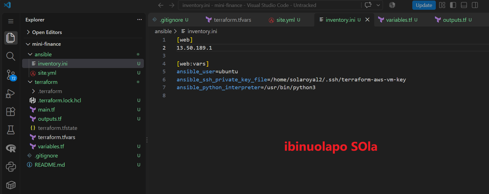

---

### Notes

that is the project structure

---

# Task 2 — Create the Azure Infrastructure Using Terraform

## Goal

Use Terraform to provision an Ubuntu Virtual Machine with the required Azure networking and security resources.

### Evidence

#### Screenshot 2 — Terraform code showing the `Allow-SSH` rule for port `22` and the `Allow-HTTP` rule for port `80`

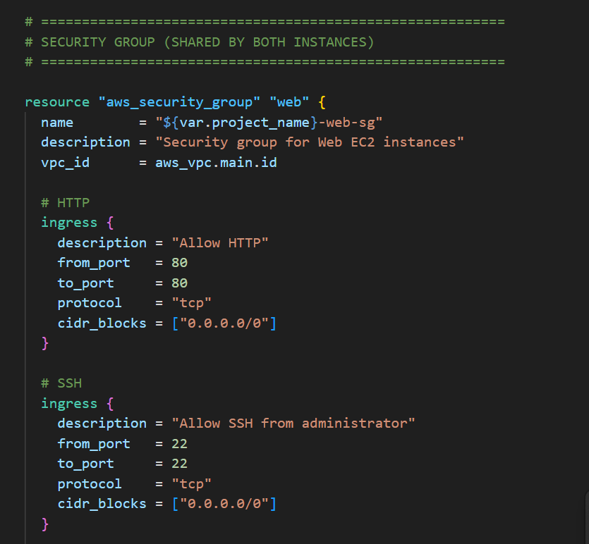

---

#### Screenshot 3 — Terraform code showing the association between `nsg-mini-finance` and `nic-mini-finance`

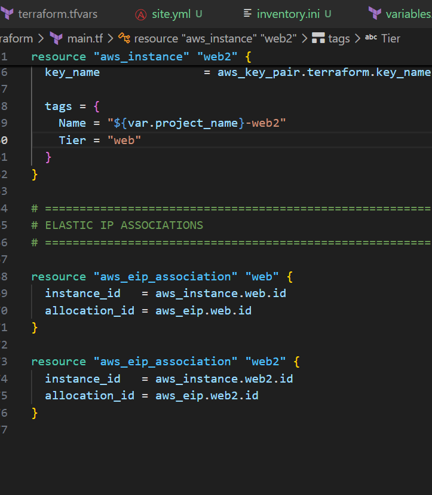

---

### Notes

I used AWS and that is the association for the was own

---

# Task 3 — Initialize and Apply the Terraform Configuration

## Goal

Format and validate the Terraform configuration, review the execution plan, and provision the Azure infrastructure.

### Evidence

#### Screenshot 4 — End of the `terraform apply` output showing `Apply complete!` with no errors

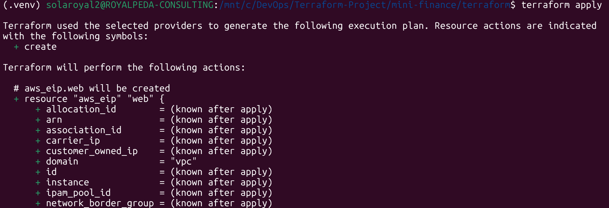
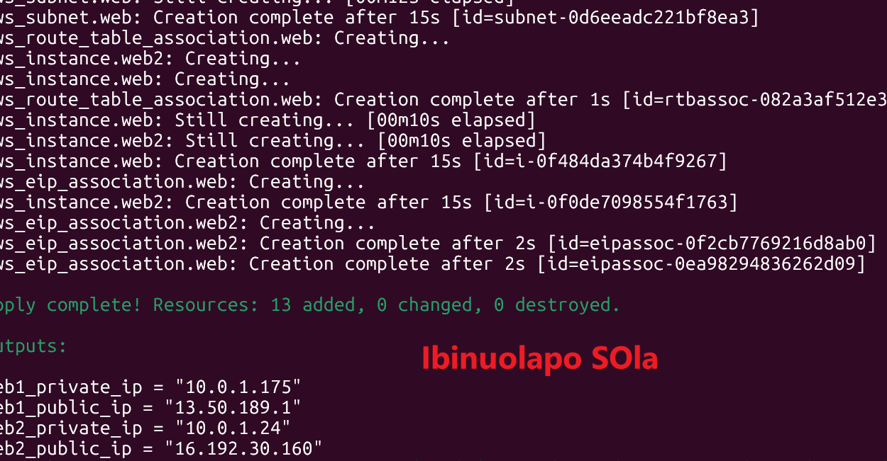

---

#### Screenshot 5 — Output of `terraform output public_ip` showing the VM’s public IP address

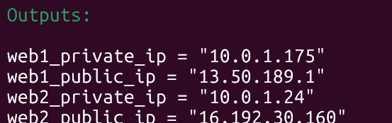

---

### Notes

it because of the configuration, it output two instance but i am making use of 1

---

# Task 4 — Verify Passwordless SSH Access

## Goal

Confirm that the Ansible controller can connect to the Terraform-provisioned Azure VM using SSH key authentication.

### Evidence

#### Screenshot 6 — Passwordless SSH command and the returned `mini-finance` hostname

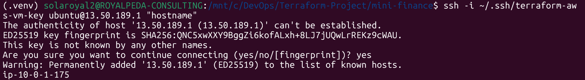

---

### Notes

It work perfectly

---

# Task 5 — Create the Ansible Inventory and Verify Connectivity

## Goal

Add the Terraform-provisioned Azure VM to the Ansible inventory and confirm that Ansible can connect to it.

### Evidence

#### Screenshot 7 — Ansible ping output showing `SUCCESS` and `pong` from the Azure VM

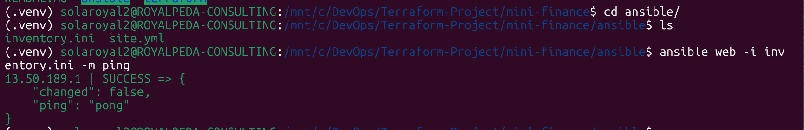

---

### Configuration File

Copy and paste the complete contents of your `ansible/inventory.ini` file below:

```ini
[web]
13.50.189.1

[web:vars]
ansible_user=ubuntu
ansible_ssh_private_key_file=/home/solaroyal2/.ssh/terraform-aws-vm-key
ansible_python_interpreter=/usr/bin/python3

```

---

# Task 6 — Create the Multi-Play Ansible Playbook

## Goal

Create one Ansible playbook containing separate plays to install Nginx, deploy the Mini Finance website, and verify the deployment.

### Evidence

#### Screenshot 8 — `site.yml` showing Play 1 and the beginning of Play 2

Screenshot must show:

- Play 1 targeting the `web` group
- Installation of `nginx`, `git`, and `rsync`
- Nginx service configured as started and enabled
- Beginning of Play 2 with the Git repository URL and synchronization task

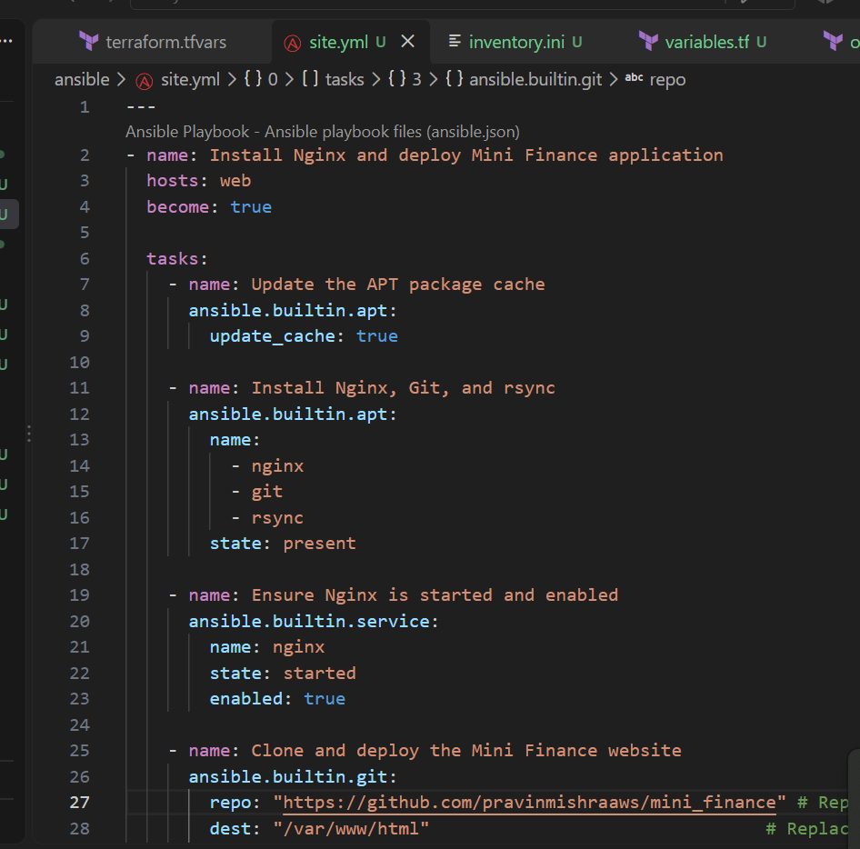

---

#### Screenshot 9 — `site.yml` showing the deployment destination, handler, and Play 3 verification

Screenshot must show:

- Website destination `/var/www/html/`
- Ownership set to `www-data:www-data`
- Nginx reload handler
- Play 3 targeting `localhost`
- The `uri` verification and `assert` condition

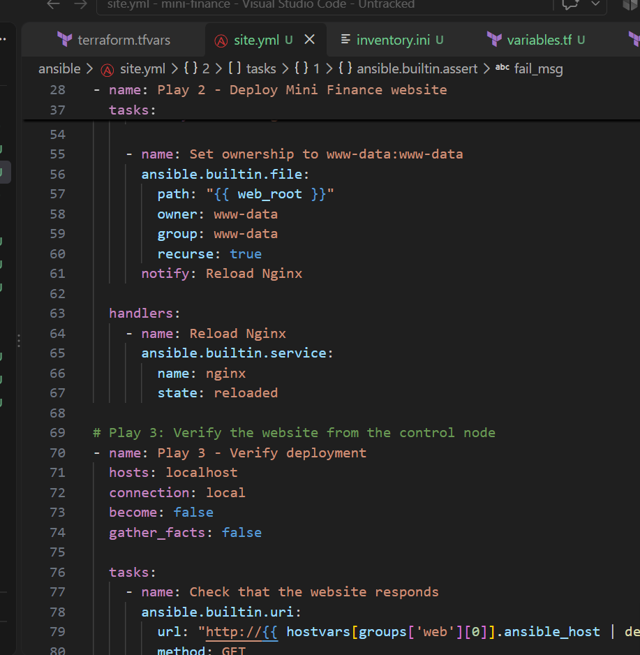

---

### Configuration File

Copy and paste the complete contents of your `ansible/site.yml` file below:

```yaml
---
# Play 1: Install and prepare Nginx on the web group
- name: Play 1 - Install Nginx, Git, and rsync
  hosts: web
  become: true

  tasks:
    - name: Update the APT package cache
      ansible.builtin.apt:
        update_cache: true
        cache_valid_time: 3600

    - name: Install Nginx, Git, and rsync
      ansible.builtin.apt:
        name:
          - nginx
          - git
          - rsync
        state: present

    - name: Ensure Nginx is started and enabled
      ansible.builtin.service:
        name: nginx
        state: started
        enabled: true

# Play 2: Clone the repo and sync it to the web root
- name: Play 2 - Deploy Mini Finance website
  hosts: web
  become: true

  vars:
    repo_url: "https://github.com/pravinmishraaws/mini_finance"
    repo_dest: "/tmp/mini_finance"
    web_root: "/var/www/html/"

  tasks:
    - name: Clone the Git repository
      ansible.builtin.git:
        repo: "{{ repo_url }}"
        dest: "{{ repo_dest }}"
        version: main
        force: true

    - name: Sync website files to /var/www/html/
      ansible.posix.synchronize:
        src: "{{ repo_dest }}/"
        dest: "{{ web_root }}"
        delete: true
        rsync_opts:
          - "--exclude=.git"
      delegate_to: "{{ inventory_hostname }}"
      notify: Reload Nginx

    - name: Set ownership to www-data:www-data
      ansible.builtin.file:
        path: "{{ web_root }}"
        owner: www-data
        group: www-data
        recurse: true
      notify: Reload Nginx

  handlers:
    - name: Reload Nginx
      ansible.builtin.service:
        name: nginx
        state: reloaded

# Play 3: Verify the website from the control node
- name: Play 3 - Verify deployment
  hosts: localhost
  connection: local
  become: false
  gather_facts: false

  tasks:
    - name: Check that the website responds
      ansible.builtin.uri:
        url: "http://{{ hostvars[groups['web'][0]].ansible_host | default(groups['web'][0]) }}"
        method: GET
        status_code: 200
        return_content: true
      register: site_check

    - name: Assert the website is working
      ansible.builtin.assert:
        that:
          - site_check.status == 200
        success_msg: "Website is up and returned HTTP 200"
        fail_msg: "Website check failed"
```

---

# Task 7 — Validate and Run the Ansible Playbook

## Goal

Validate the syntax of the multi-play Ansible playbook and run it to install Nginx, deploy the Mini Finance website, and verify the deployment.

### Evidence

#### Screenshot 10 — Successful playbook syntax check showing `playbook: site.yml`

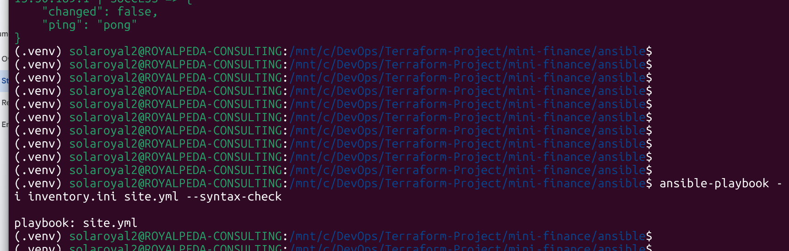

---

#### Screenshot 11 — Play 3 output showing the successful HTTP verification and assertion

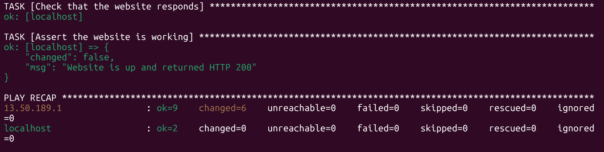

---

#### Screenshot 12 — Final `PLAY RECAP` showing `failed=0` and `unreachable=0`

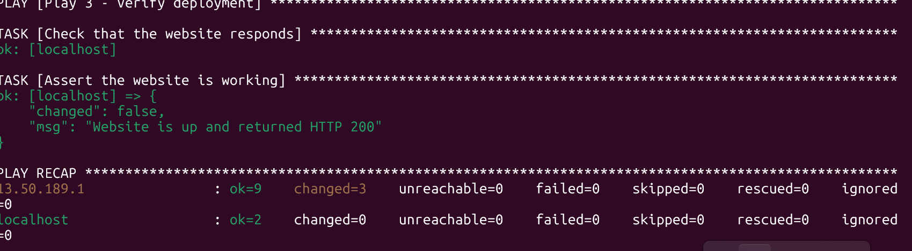

---

### Notes

There is no big difference between the two

---

# Task 8 — Test the Mini Finance Website in a Browser

## Goal

Confirm that the Mini Finance website is publicly accessible through the Azure VM’s public IP address.

### Evidence

#### Screenshot 13 — Mini Finance website successfully loading in the browser, with the Azure VM’s public IP address visible in the address bar

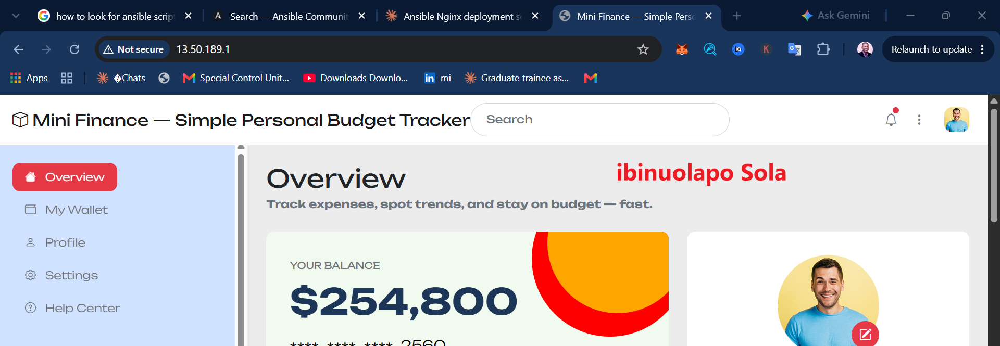

---

### Website URL

Add your deployed website URL below:

```text
http://13.50.189.1/
```

---

# Task 9 — Create the Project README

## Goal

Create a `README.md` file to document the Mini Finance infrastructure and deployment project.

### Evidence

#### Screenshot 14 — Completed `README.md` displayed in the VS Code Markdown preview or terminal

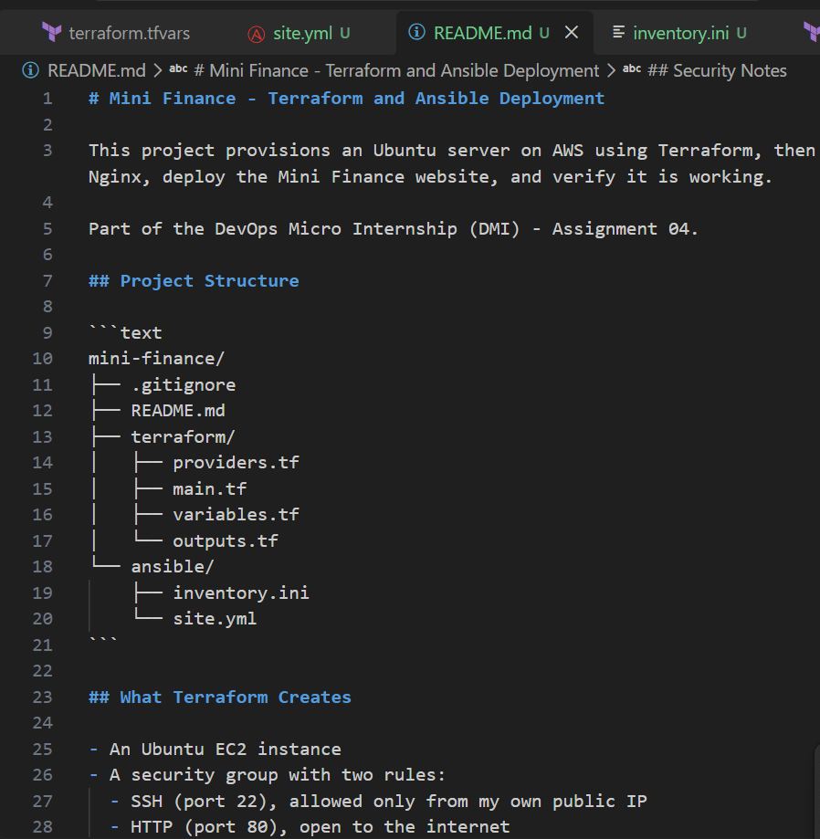

---

### README Content

Copy and paste the complete contents of your `README.md` file below:

```markdown
# Mini Finance - Terraform and Ansible Deployment

This project provisions an Ubuntu server on AWS using Terraform, then uses Ansible to install Nginx, deploy the Mini Finance website, and verify it is working.

Part of the DevOps Micro Internship (DMI) - Assignment 04.

## Project Structure

```text
mini-finance/
├── .gitignore
├── README.md
├── terraform/
│   ├── providers.tf
│   ├── main.tf
│   ├── variables.tf
│   └── outputs.tf
└── ansible/
    ├── inventory.ini
    └── site.yml
```

## What Terraform Creates

- An Ubuntu EC2 instance
- A security group with two rules:
  - SSH (port 22), allowed only from my own public IP
  - HTTP (port 80), open to the internet
- An SSH key pair for passwordless login
- An output for the server public IP

Note: my configuration output two instances, but I only used one of them.

## What Ansible Does

`site.yml` has three plays:

1. **Play 1 (web group):** installs `nginx`, `git`, and `rsync`, and makes sure Nginx is started and enabled.
2. **Play 2 (web group):** clones the Mini Finance repo, syncs the files to `/var/www/html/` with rsync, sets ownership to `www-data:www-data`, and reloads Nginx with a handler.
3. **Play 3 (localhost):** uses the `uri` module to check the website returns HTTP 200, then uses `assert` to confirm it.

## Requirements

- Terraform
- Ansible
- AWS account and credentials configured locally
- The `ansible.posix` collection (needed for the `synchronize` module)

```bash
ansible-galaxy collection install ansible.posix
```

## How to Run

### 1. Provision the server

```bash
cd terraform
terraform fmt
terraform init
terraform validate
terraform plan
terraform apply
terraform output public_ip
```

### 2. Test SSH access

```bash
ssh -i ~/.ssh/<your-private-key> ubuntu@<public-ip>
```

### 3. Update the inventory

Put the server public IP in `ansible/inventory.ini`:

```ini
[web]
<public-ip>

[web:vars]
ansible_user=ubuntu
ansible_ssh_private_key_file=~/.ssh/<your-private-key>
ansible_python_interpreter=/usr/bin/python3
```

### 4. Check connection and run the playbook

```bash
cd ../ansible
ansible -i inventory.ini web -m ping
ansible-playbook -i inventory.ini site.yml --syntax-check
ansible-playbook -i inventory.ini site.yml
```

### 5. Open the website

```text
http://<public-ip>/
```

## Result

- Terraform apply completed with no errors
- Passwordless SSH works
- Ansible ping returns `SUCCESS` and `pong`
- Playbook finished with `failed=0` and `unreachable=0`
- Mini Finance website loads in the browser

## Security Notes

- SSH is restricted to my own IP, not open to everyone.
- Private keys, Terraform state files, and credentials are not committed. They are listed in `.gitignore`.

## Clean Up

To avoid AWS charges when you are done:

```bash
cd terraform
terraform destroy
```
```

---

# LinkedIn Post Required

## Evidence

#### Screenshot 15 — Published LinkedIn post showing the text and at least one deployment screenshot

Add your screenshot here.

---

#### LinkedIn Post URL

Paste your LinkedIn post URL here:

`Add your URL here`

---

### LinkedIn Submission Notes

**One challenge you faced and how you fixed it:**

There is no challengs on this at all

---

**One real-world example where you can use this learning:**

I can use this in a project where i am to configure application and deploy it instead of mannual hand, i will use ansible

---

# Assignment Questions

Answer the following in your own words:

**1. What did you provision using Terraform in this assignment?**

In provision terraform 

---

**2. What did Ansible configure and deploy in this assignment?**

I configure infracstructure i provision using terraform.

---

**3. Why is SSH access on port `22` restricted to your public IP address?**

we only allow my own Ip address to have access to it instead of public

---

**4. Why is HTTP port `80` open to the internet?**

So that we can access our deployed applications through it.

---

**5. What is the purpose of the Ansible inventory file?**

The purpose of ansible inventory file is to make sure it configure ansible with the web server

---

**6. Why does the playbook use separate plays for install, deploy, and verify?**

Technically, Plays 1 and 2 could be merged because they target the same group. I kept them separate because your instructions describe them as two plays, and it reads more clearly.

---

**7. Why is `rsync` useful when deploying website files?**

rsync is useful because it makes the deployment smart instead of just copying everything every time.

---

**8. What does the Ansible `uri` module verify in this assignment?**

The uri module verifies that the website is actually live and responding after deployment.

---

**9. What issue did you face during this assignment, and how did you fix it?**

I didnt face any issues at all

---

**10. What did you learn from using Terraform and Ansible together?**

I learn more about the ansible deployemnt and what it can do more than just configure but to deploy

---

# Required Files

Confirm that the following files are included in your assignment folder:

- [ ] `.gitignore`
- [ ] `README.md`
- [ ] `terraform/providers.tf`
- [ ] `terraform/main.tf`
- [ ] `terraform/variables.tf`
- [ ] `terraform/outputs.tf`
- [ ] `ansible/inventory.ini`
- [ ] `ansible/site.yml`

---

# Submission Instructions

- Add all required screenshots in the correct order.
- Full Name must be visible in required screenshots.
- Add the Azure VM public IP address.
- Add the final Mini Finance website URL.
- Paste `inventory.ini`, `site.yml`, and `README.md` as editable text.
- Answer all assignment questions clearly in your own words.
- Add your LinkedIn post URL.
- Do not expose SSH private keys, passwords, Azure credentials, subscription IDs, Terraform state contents, or other sensitive information.

---

# Completion Checklist

- [ ] Task 1: `mini-finance` project structure created
- [ ] Task 1: `.gitignore` created
- [ ] Task 2: Terraform Azure infrastructure code created
- [ ] Task 2: `Allow-SSH` rule configured for port `22`
- [ ] Task 2: `Allow-HTTP` rule configured for port `80`
- [ ] Task 2: NSG associated with the Network Interface
- [ ] Task 3: `terraform fmt` completed
- [ ] Task 3: `terraform init` completed
- [ ] Task 3: `terraform validate` completed successfully
- [ ] Task 3: `terraform apply` completed successfully
- [ ] Task 3: `terraform output public_ip` displayed the VM public IP
- [ ] Task 4: Passwordless SSH works from the Ansible controller
- [ ] Task 5: `inventory.ini` created
- [ ] Task 5: Ansible ping returns `SUCCESS` and `pong`
- [ ] Task 6: `site.yml` contains three separate plays
- [ ] Task 6: Play 1 installs Nginx, Git, and rsync
- [ ] Task 6: Play 2 clones and deploys the Mini Finance website
- [ ] Task 6: Play 3 verifies HTTP status code `200`
- [ ] Task 7: Playbook syntax check passes
- [ ] Task 7: Ansible playbook completes successfully
- [ ] Task 7: Final recap shows `failed=0` and `unreachable=0`
- [ ] Task 8: Mini Finance website loads in the browser
- [ ] Task 8: Azure VM public IP is visible in the browser screenshot
- [ ] Task 9: `README.md` completed
- [ ] Screenshots 1–15 are included
- [ ] `inventory.ini`, `site.yml`, and `README.md` are pasted as editable text
- [ ] Assignment questions are answered
- [ ] LinkedIn post published with Anyone visibility
- [ ] LinkedIn post URL added
- [ ] No sensitive information is exposed

---

## About DMI & CloudAdvisory

DevOps Micro Internship (DMI) is a project-based DevOps program run by Pravin Mishra and The CloudAdvisory, focused on real-world execution, systems thinking, and career readiness.

It helps learners build strong DevOps foundations with hands-on experience.

---

## Resources

- DMI Official Website: [https://dmi.pravinmishra.com?utm_source=github&utm_medium=readme](https://dmi.pravinmishra.com?utm_source=github&utm_medium=readme)
- University: [https://university.pravinmishra.com?utm_source=github&utm_medium=readme](https://university.pravinmishra.com?utm_source=github&utm_medium=readme)
- Discord Community: [https://discord.pravinmishra.com?utm_source=github&utm_medium=readme](https://discord.pravinmishra.com?utm_source=github&utm_medium=readme)
- Blog: [https://dmi.pravinmishra.com/blog?utm_source=github&utm_medium=readme](https://dmi.pravinmishra.com/blog?utm_source=github&utm_medium=readme)
- YouTube Playlist: [https://www.youtube.com/playlist?list=PLFeSNDtI4Cho](https://www.youtube.com/playlist?list=PLFeSNDtI4Cho)
- Pravin Mishra LinkedIn: [https://www.linkedin.com/in/pravin-mishra-aws-trainer/](https://www.linkedin.com/in/pravin-mishra-aws-trainer/)
- CloudAdvisory LinkedIn: [https://www.linkedin.com/company/thecloudadvisory/](https://www.linkedin.com/company/thecloudadvisory/)

---

*This submission is part of DevOps Micro Internship (DMI) — Agentic AI Track.*