# Assignment — Deploy EpicBook with Terraform and Ansible Roles

Part of the DevOps Micro Internship (DMI) with Agentic AI

---

## Purpose

In this assignment, you will deploy the EpicBook web application using Terraform and Ansible roles.

Terraform provisions the cloud infrastructure, including one Ubuntu VM and one managed MySQL database. Ansible roles configure the VM, install required software, deploy the EpicBook application, configure Nginx, connect the app to the managed MySQL database, and verify the deployment.

---

# Task 1 — Set Up the Project Folder Layout

## Goal

Create the project folder structure for Terraform and Ansible roles.

Terraform will be used to provision the cloud infrastructure. Ansible roles will be used to configure the VM and deploy the EpicBook application.

### Evidence

#### Screenshot 1 — Terminal showing the completed `epicbook-prod` project structure

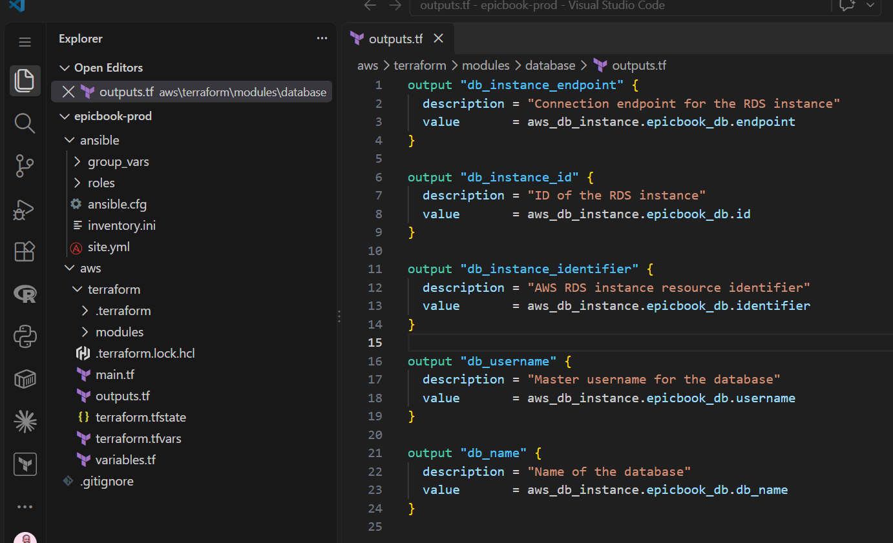

---

### Notes

Answer the following in your own words:

**1. Which cloud provider did you choose for this assignment?**

AWS

---

**2. Why is it useful to keep Terraform files and Ansible files in separate folders?**

Keeping them separate avoids file clutter, prevents accidental edits, and lets infrastructure and software configurations scale independently.

---

**3. What is the purpose of the `roles` directory in Ansible?**

It organizes Ansible code into structured, reusable modules (separating tasks, variables, handlers, and templates). This keeps main playbooks clean and readable.

---

# Task 2 — Provision the Infrastructure with Terraform

## Goal

Run Terraform to provision the cloud infrastructure for the EpicBook deployment.

Terraform will create the VM, managed MySQL database, networking, security rules, and required outputs.

### Evidence

#### Screenshot 2 — `terraform apply` completed successfully

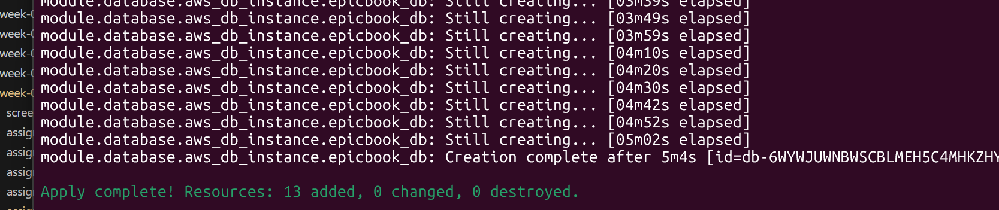

---

#### Screenshot 3 — Output of `terraform output`

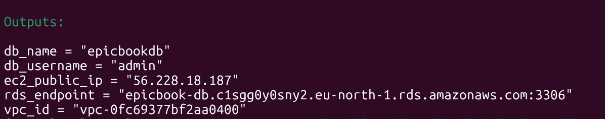

---

#### Screenshot 4 — Azure Portal or AWS Console showing the VM running

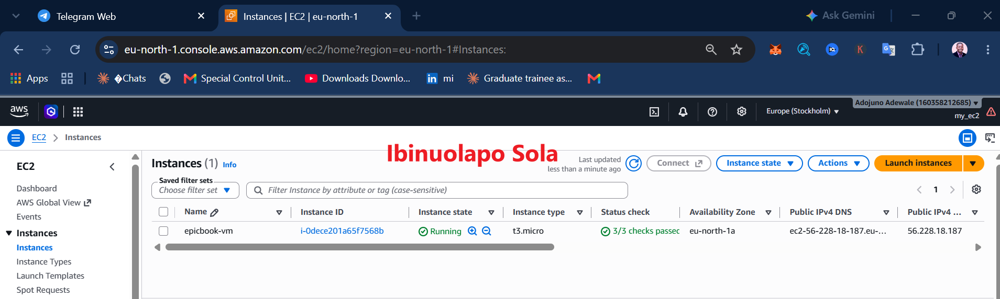

---

#### Screenshot 5 — Azure Portal or AWS Console showing the managed MySQL database created

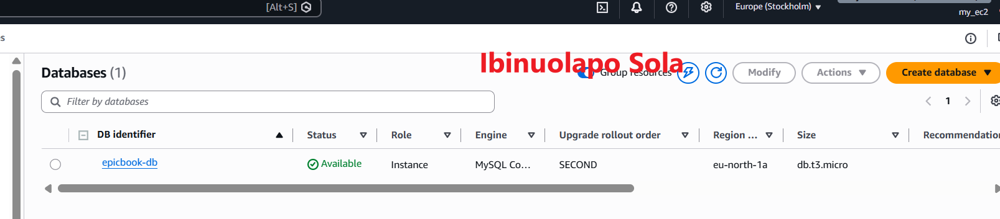

---

### Notes

Answer the following in your own words:

**1. What resources did Terraform create for this assignment?**

Virtual Machine EC2

Managed Database RDS

Networking VPC

Security Rules Security Groups e,g SSH port 22, HTTP port 80, MySQL port 3306

---

**2. Why should you review `terraform plan` before running `terraform apply`?**

To verify exact proposed changes before applying them, preventing accidental deletion or unexpected destruction/recreation of live resources.

---

**3. Why should database passwords not be shown in Terraform output?**

Terraform output prints in plain text in terminal logs and CI/CD pipelines. Exposing passwords creates a major security vulnerability where unauthorized users can extract plain-text credentials.

---

# Task 3 — Verify SSH Key-Based Access

## Goal

Verify that the cloud VM can be accessed from the Ansible controller using SSH key-based authentication.

### Evidence

#### Screenshot 6 — Successful SSH hostname check from the Ansible controller

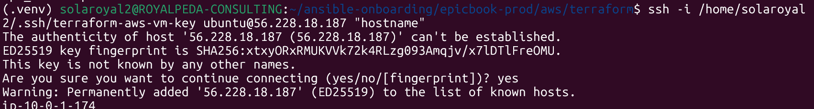

---

### Notes

Answer the following in your own words:

**1. What command did you use to verify SSH access?**

ssh -i ~/.ssh/id_rsa ubuntu@<VM_PUBLIC_IP> (or ssh ubuntu@<VM_PUBLIC_IP>

---

**2. What proves that SSH key-based access worked successfully?**

It bring the private Ip address

---

**3. What would you check if SSH returned `Permission denied (publickey)`?**

Verify the private key file has restricted permissions (chmod 400 ~/.ssh/id_rsa).

---

# Task 4 — Create the Ansible Inventory and Configuration

## Goal

Create the Ansible inventory file and local Ansible configuration for the EpicBook VM.

The inventory tells Ansible which VM to manage and which SSH user to use.

### Evidence

#### Screenshot 7 — `inventory.ini` showing the VM under the `web` group

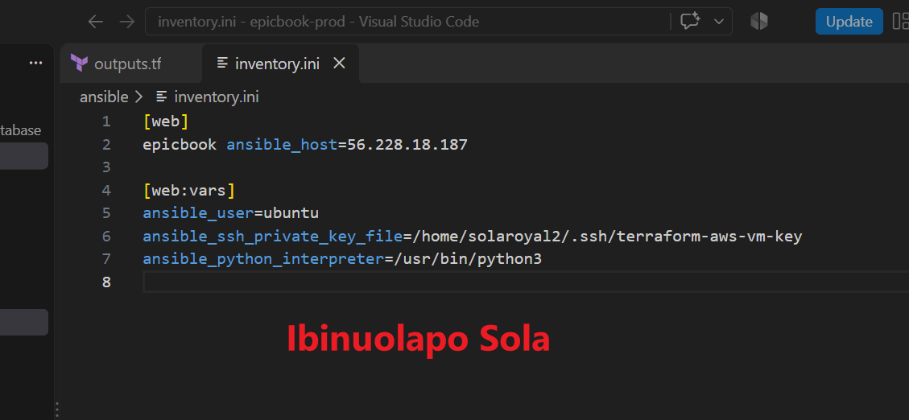

---

#### Screenshot 8 — Output of `ansible-inventory -i inventory.ini --graph`

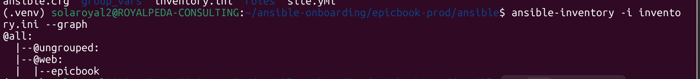

---

#### Screenshot 9 — Output of `ansible web -i inventory.ini -m ping`

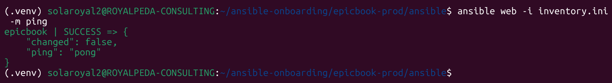

---

### Notes

Answer the following in your own words:

**1. What is the purpose of `inventory.ini`?**

It is a configuration file used by the Ansible controller to list target managed servers (their IP addresses, group names, and host variables) so Ansible knows which resources to connect to and configure

---

**2. What does `ansible_host` store?**

It stores the exact IP address or domain name of the remote target server that Ansible connects to over SSH.

---

**3. What does `ansible_ssh_private_key_file` tell Ansible?**

It specifies the exact path on your controller to the SSH private key file required to authenticate and log into the target server without requiring a password

---

**4. Why is `host_key_checking = False` used only for this temporary lab?**

It disables the interactive SSH prompt asking to verify new/unknown host fingerprints, allowing automated lab scripts to run without pausing.

---

# Task 5 — Create the Main Ansible Playbook

## Goal

Create the main Ansible playbook that runs the required roles in the correct order.

The `site.yml` file will call the `common`, `nginx`, and `epicbook` roles.

### Evidence

#### Screenshot 10 — `site.yml` showing the roles in the correct order

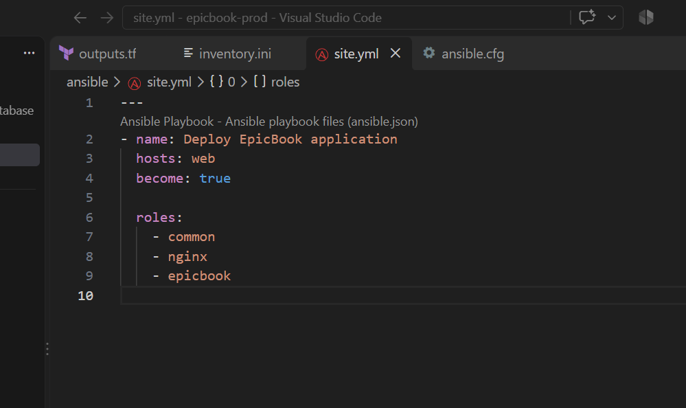

---

#### Screenshot 11 — Output of `ansible-playbook -i inventory.ini site.yml --syntax-check`

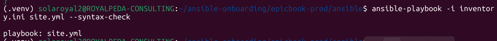

---

### Notes

Answer the following in your own words:

**1. What is the purpose of `site.yml`?**

It acts as the master entry-point playbook that orchestrates your deployment by mapping target host groups to the execution roles they need to run.

---

**2. Why should the roles run in the order `common`, `nginx`, and `epicbook`?**

`common` first: Prepares the system by updating package managers and installing basic system utilities.

`nginx` second: Installs and configures the web server and reverse proxy framework.

`epicbook` third: Deploys the application code and configures database connections, which rely on both base tools and Nginx being ready.

---

**3. What does `become: true` allow Ansible to do?**

It escalates task execution privileges to root/administrator leve

---

# Task 6 — Create the `common` Role

## Goal

Create the `common` role to prepare the Ubuntu VM with the basic packages required for the EpicBook deployment.

This role handles the common server setup before Nginx and the application are configured.

### Evidence

#### Screenshot 12 — `roles/common/tasks/main.yml` showing the common setup tasks

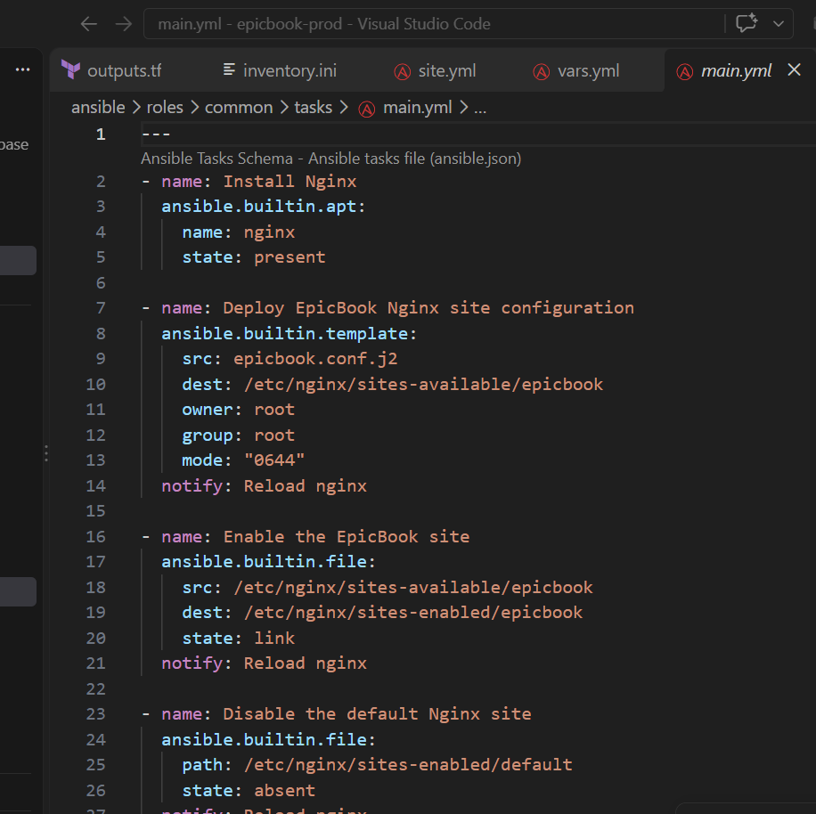

---

### Notes

Answer the following in your own words:

**1. What is the responsibility of the `common` role?**

It handles baseline OS setup across managed hosts, such as updating package repositories, configuring system utilities, and installing shared dependencies (git, curl, system libraries).

---

**2. Why should Nginx installation not be placed inside the `common` role?**

To maintain modularity and separation of concerns

---

**3. Why is `mysql-client` useful in this deployment?**

It allows the web server VM to connect to the remote managed RDS/MySQL database directly from the command line to test connectivity, verify permissions, and import database schemas.

---

# Task 7 — Create the `nginx` Role

## Goal

Create the `nginx` role to install Nginx and configure it as a reverse proxy for the EpicBook application.

Nginx will receive browser traffic on port `80` and forward it to the EpicBook Node.js application running on the VM.

### Evidence

#### Screenshot 13 — `roles/nginx/tasks/main.yml` showing Nginx installation and site configuration tasks

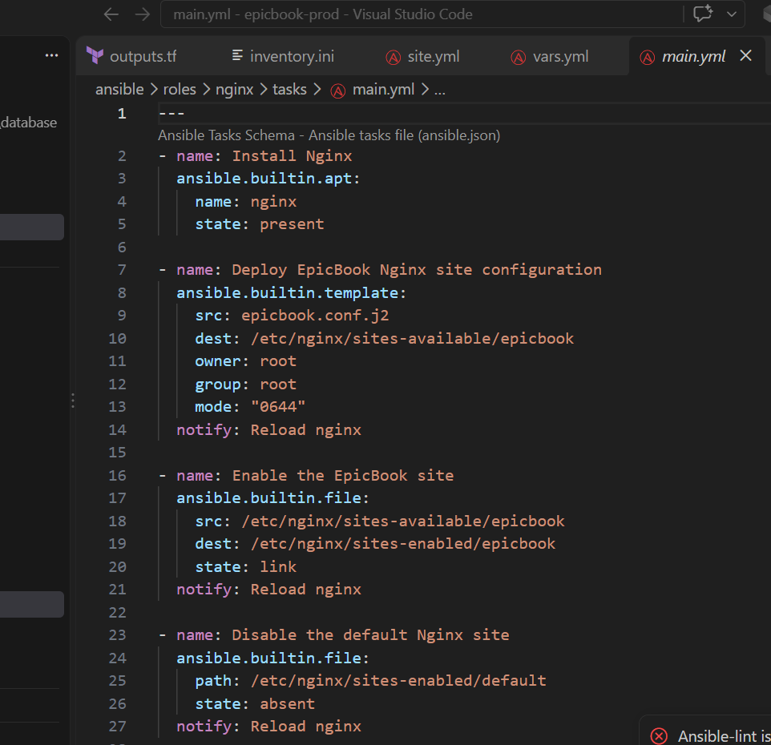

---

#### Screenshot 14 — `roles/nginx/templates/epicbook.conf.j2` showing the reverse proxy configuration

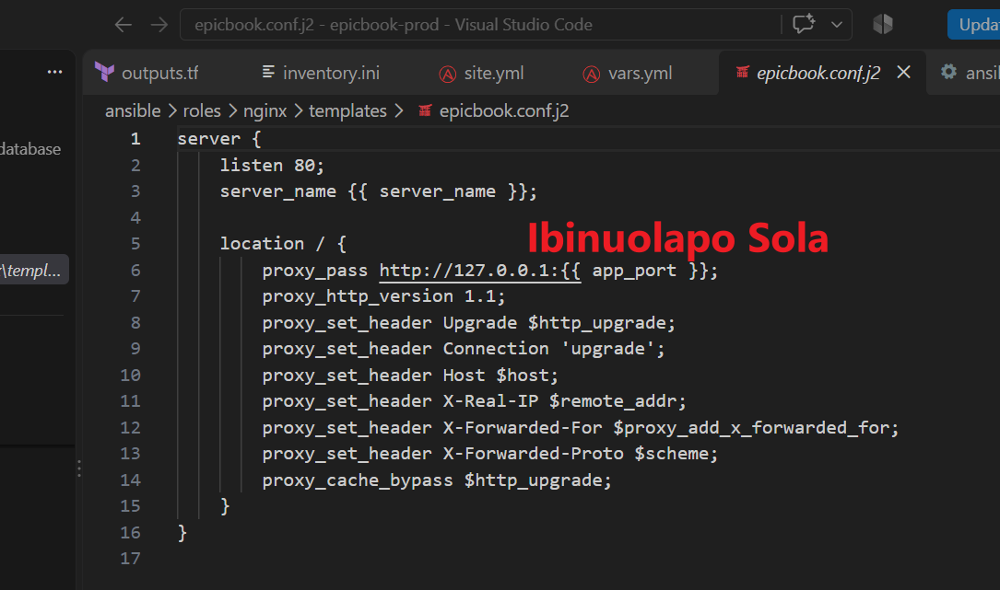

---

### Notes

Answer the following in your own words:

**1. What is the responsibility of the `nginx` role?**

It installs Nginx, applies the custom virtual host configuration, enables the site, and ensures the Nginx service is running and enabled on boot

---

**2. Why is Nginx configured as a reverse proxy in this deployment?**

Nginx receives public web traffic on standard HTTP port 80 and safely forwards (proxies) it to the backend Node.js application running internally on port 8080.

---

**3. Why should the application port come from `group_vars/web.yml` instead of being hard-coded?**

Storing the port in a central variable file makes configuration modular and maintainable. If the port changes later, you only update it once in group_vars/web.yml instead of manually editing multiple task files and Nginx templates.

---

# Task 8 — Create the `epicbook` Role

## Goal

Create the `epicbook` role to deploy the EpicBook application, connect it to the managed MySQL database, and run the application on port `8080` using PM2.

### Evidence

#### Screenshot 15 — `roles/epicbook/tasks/main.yml` showing application deployment tasks

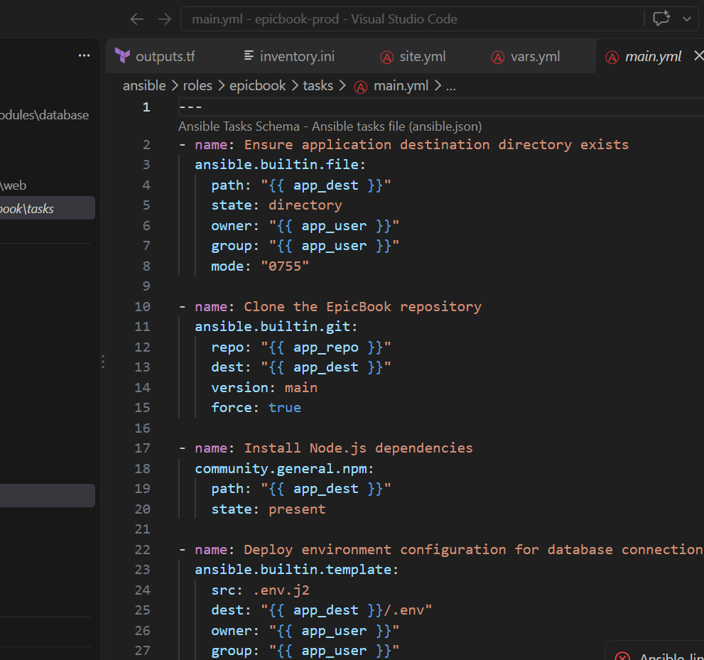

---

#### Screenshot 16 — Task or file showing how the database connection is configured, with secrets hidden

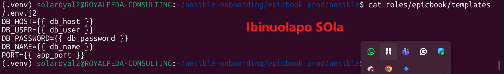

---

#### Screenshot 17 — Task or output showing the EpicBook application managed by PM2

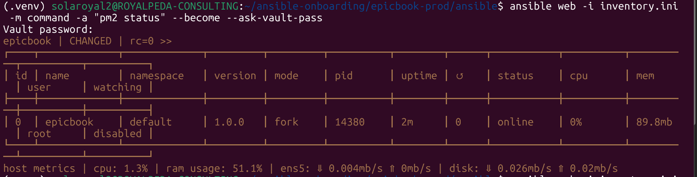

---

### Notes

Answer the following in your own words:

**1. What is the responsibility of the `epicbook` role?**

It handles the application-level setup, which includes cloning the application repository, installing Node.js dependencies (npm install), rendering environment configuration files (.env) for database connectivity, and starting and managing the Express application process using PM2.

---

**2. Why is PM2 used for the EpicBook Node.js application?**

PM2 is a production process manager for Node.js that runs the application continuously in the background, automatically restarts it if it encounters an unhandled exception or if the server reboots, and provides process monitoring and log management tools.

---

**3. Why should database passwords not be hard-coded in public files?**

Hardcoding credentials stores sensitive secrets in plain text, exposing them to anyone with repository access or leaking them if pushed to public source control (such as GitHub). Securing passwords in encrypted vaults or environment variables prevents unauthorized database access and credential exposure.

---

**4. What does it mean for the application to run on port `8080` while Nginx listens on port `80`?**

This architecture uses Nginx as a reverse proxy. Nginx listens publicly on standard web port 80 to accept incoming user HTTP requests, and then forwards (proxies) those requests internally to the Node.js application running isolated on port 8080. This shields the application server from direct public internet exposure while providing a single entry point for traffic management.

---

# Task 9 — Create Group Variables

## Goal

Create reusable variables for the EpicBook deployment.

The `group_vars/web.yml` file stores values that can be reused across the Ansible roles.

### Evidence

#### Screenshot 18 — `group_vars/web.yml` showing the application, PM2, and database variables, with passwords hidden or masked

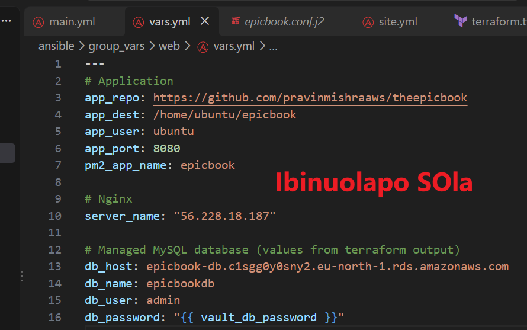

---

### Notes

Answer the following in your own words:

**1. What is the purpose of `group_vars/web.yml`?**

It defines group-level configuration variables specifically for host machines in the web inventory group. This separates configuration data from playbook logic, ensuring variables can be managed centrally and reused across different roles.

---

**2. Which values did you store in `group_vars/web.yml`?**

Non-sensitive configuration parameters used across the web group, including:

Database Endpoint (db_host): epicbook-db.c1sgg0y0sny2.eu-north-1.rds.amazonaws.com

Database Name (db_name): epicbookdb

Database User (db_user): admin

Application Port (app_port): 8080

Repository URL & Deployment Path: Repository link for the source code and target directory (/home/ubuntu/epicbook).

---

**3. How did you handle the database password securely?**

The database password (db_password) was managed using Ansible Vault. The sensitive value was encrypted inside group_vars/web/vault.yml using ansible-vault encrypt

---

# Task 10 — Run the Ansible Playbook

## Goal

Run the Ansible playbook to configure the VM and deploy the EpicBook application.

The playbook should run the roles in this order:

1. `common`
2. `nginx`
3. `epicbook`

### Evidence

#### Screenshot 19 — Ansible playbook output showing the roles running

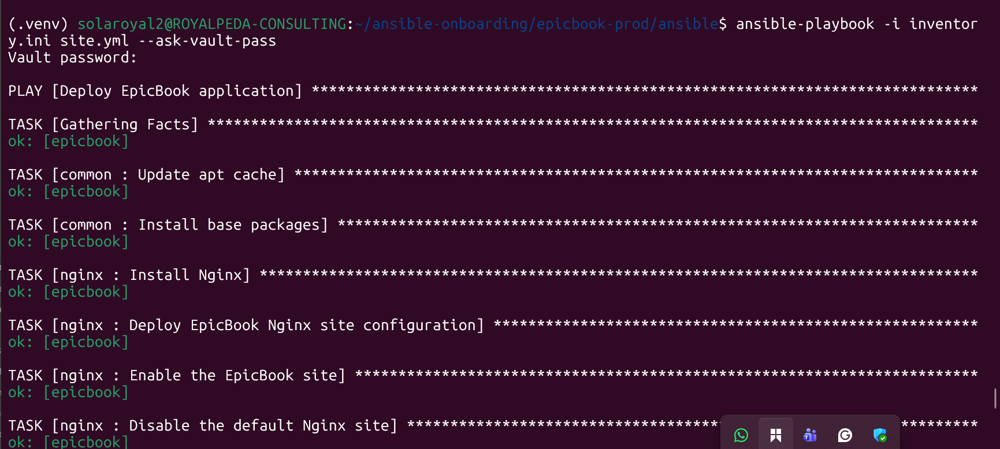
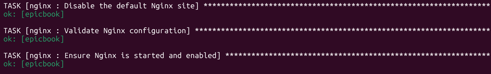
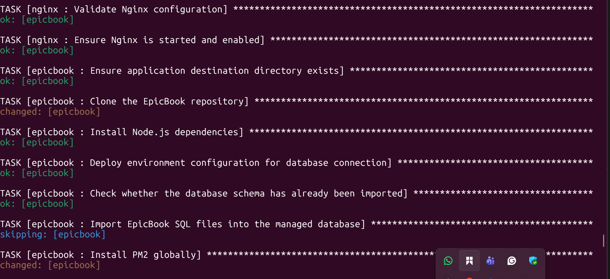

---

#### Screenshot 20 — Final Ansible recap showing `failed=0`

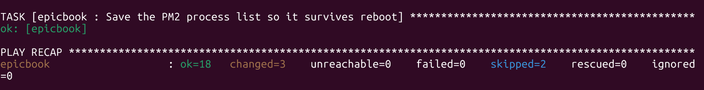

---

#### Screenshot 21 — Output of `ansible web -i inventory.ini -m command -a "systemctl is-active nginx" --become`

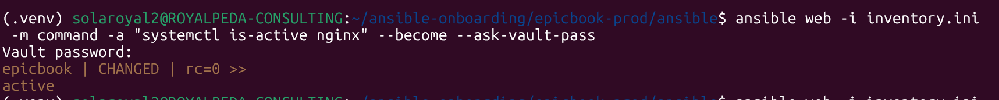

---

#### Screenshot 22 — Output of `ansible web -i inventory.ini -m command -a "pm2 status"`

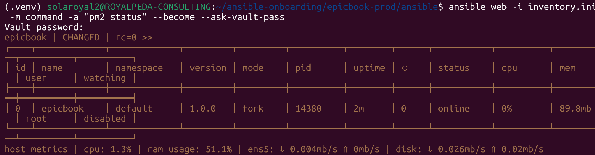

---

#### Screenshot 23 — Output of `ansible web -i inventory.ini -m command -a "curl -I http://localhost:8080"`

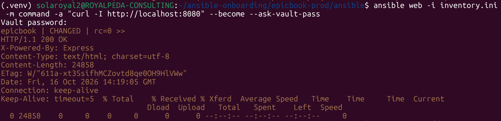

---

### Notes

Answer the following in your own words:

**1. What command did you run to execute the Ansible playbook?**

ansible-playbook -i inventory.ini site.yml --ask-vault-pass

---

**2. How do you know all roles completed successfully?**

The final PLAY RECAP output showed `failed=0` and unreachable=0, with all 18 tasks across the common, nginx, and epicbook roles returning status ok or changed

---

**3. What proves that Nginx is active?**

Running ansible web -i inventory.ini -m command -a "systemctl is-active nginx" returned active, and curl -I http://localhost returned an HTTP/1.1 200 OK header.

---

**4. What proves that PM2 is managing the EpicBook application?**

Running ansible web -i inventory.ini -m command -a "pm2 status" showed the epicbook process listed with status online under PID 14380

---

**5. What proves that the EpicBook application responds on port `8080`?**

ansible web -i inventory.ini -m command -a "curl -I http://localhost:8080" returned HTTP/1.1 200 OK with the header X-Powered-By: Express

---

# Task 11 — Verify the EpicBook Deployment

## Goal

Verify that the EpicBook application is running, accessible in the browser, and connected to the managed MySQL database.

### Evidence

#### Screenshot 24 — Output of `curl -I http://<public_ip>`

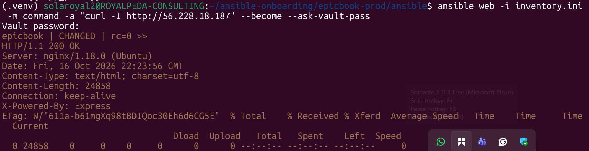

---

#### Screenshot 25 — Output of the cart API test command

---

#### Screenshot 26 — Output of the `/cart` HTTP status check

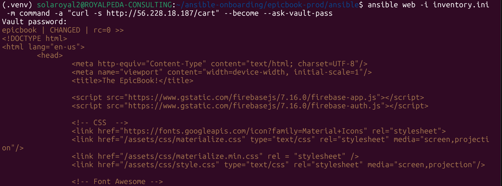

---

#### Screenshot 27 — Browser showing the EpicBook application loaded from `http://<public_ip>`

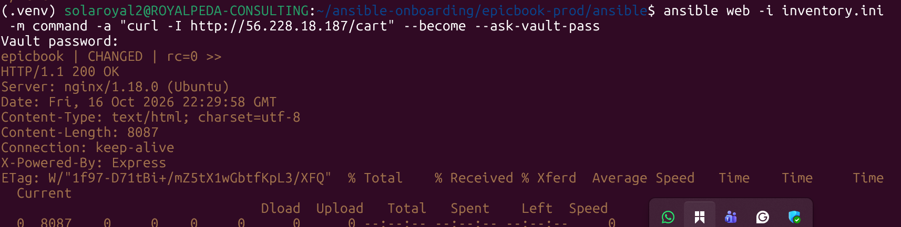

---

### Notes

Answer the following in your own words:

**1. What HTTP response did you receive from the public application URL?**

HTTP/1.1 200 OK

---

**2. What did the cart API test prove?**

It proved that the Node.js application is connected to the AWS RDS MySQL database (epicbookdb) and can read/write data from the database tables. 

---

**3. What did the `/cart` status check return?**

HTTP/1.1 200 OK

---

**4. What issue did you face during verification, and how did you fix it?**

The default Nginx landing page was being displayed instead of the application because the default virtual host configuration was still active. This was resolved by removing /etc/nginx/sites-enabled/default and reloading Nginx (systemctl reload nginx).

---

# LinkedIn Post Required

## Evidence

#### LinkedIn Post URL

Paste your LinkedIn post URL here:

`Add your URL here`

---

#### Screenshot — Published LinkedIn post

Add your screenshot here.

---

# Assignment Questions

Answer the following in your own words:

**1. Why is Terraform used for infrastructure provisioning?**

Terraform provides Infrastructure as Code (IaC) using a declarative workflow. It automates the creation, modification, and destruction of cloud resources (EC2, RDS, Security Groups, VPCs) while tracking system state, enabling reproducible and version-controlled infrastructure deployment.

---

**2. Why are Ansible roles useful for production-style deployments?**

Ansible roles break complex playbooks into modular, reusable directory structures (separating tasks, handlers, variables, and templates). This improves maintainability, reduces code duplication, and allows independent management of distinct concerns (e.g., base packages, web servers, applications).

---

**3. What is the purpose of `group_vars/web.yml`?**

It centralizes non-sensitive configuration variables (such as database endpoint URLs, application port numbers, and repository locations) specific to hosts in the web inventory group, keeping variable logic separate from playbook tasks.

---

**4. Why should database passwords not be committed to GitHub?**

Hardcoding credentials in public repositories exposes sensitive database instances to unauthorized access, data leaks, and malicious attacks. Secrets must be encrypted using tools like Ansible Vault or injected dynamically via environment variables.

---

**5. What is the purpose of Nginx in this deployment?**

Nginx acts as a reverse proxy server listening on public HTTP port 80. It accepts incoming client traffic, handles request header processing, and forwards requests to the isolated Node.js application running on internal port 8080.

---

**6. Why should the managed MySQL database not be publicly accessible?**

Restricting public access minimizes the database's attack surface. The database should only accept connections on port 3306 originating internally from authorized EC2 instance security groups within the VPC.

---

**7. Why is PM2 used for the EpicBook Node.js application?**

PM2 is a production process manager that keeps Node.js applications running continuously in the background, automatically restarts the app if it crashes or the server reboots, and provides logging and resource monitoring.

---

**8. What does idempotency mean in Ansible?**

Idempotency guarantees that executing an Ansible playbook multiple times on a target system produces the exact same end state without applying unnecessary changes or causing duplicate side effects.

---

**9. What issue did you face during the deployment, and how did you fix it?**

The SQL schema file initially failed to import because it referenced USE bookstore; instead of USE epicbookdb;. This was resolved by executing sed to update all database references in the SQL files to epicbookdb before re-running the import commands.

---

**10. What security improvement would you make before using this setup in production?**

Implement SSL/TLS termination by configuring an HTTPS certificate (via Let's Encrypt / AWS ACM) on Nginx on port 443, and place the EC2 application instance in a private subnet behind an Application Load Balancer (ALB)

---

# Required Files

Confirm that the following files are included in your GitHub repository or assignment folder:

- [ ] `README.md`
- [ ] Terraform files under either `terraform/azure/` or `terraform/aws/`
- [ ] `ansible/ansible.cfg`
- [ ] `ansible/inventory.ini`
- [ ] `ansible/site.yml`
- [ ] `ansible/group_vars/web.yml`
- [ ] `ansible/roles/common/tasks/main.yml`
- [ ] `ansible/roles/nginx/tasks/main.yml`
- [ ] `ansible/roles/nginx/templates/epicbook.conf.j2`
- [ ] `ansible/roles/epicbook/tasks/main.yml`

---

# Submission Instructions

- Add all required screenshots in your submission.
- Full Name must be visible in required screenshots.
- Mention the cloud provider used: Azure or AWS.
- Add the VM public IP address.
- Add the final application URL.
- Add Terraform output proof.
- Add Ansible role tree proof.
- Add all required notes and assignment question answers.
- Add your LinkedIn post URL.
- Do not expose SSH private keys, passwords, cloud credentials, database credentials, Terraform state files, subscription IDs, or account IDs.

---

# Completion Checklist

- [ ] Task 1: Project folder layout created
- [ ] Task 2: Terraform infrastructure provisioned
- [ ] Task 3: SSH key-based access verified
- [ ] Task 4: Ansible inventory and configuration created
- [ ] Task 5: Main Ansible playbook created
- [ ] Task 6: `common` role created
- [ ] Task 7: `nginx` role created
- [ ] Task 8: `epicbook` role created
- [ ] Task 9: Group variables created
- [ ] Task 10: Ansible playbook run completed
- [ ] Task 11: EpicBook deployment verified
- [ ] Terraform files created under only one cloud provider folder
- [ ] One Ubuntu VM was created
- [ ] One managed MySQL database was created
- [ ] SSH port `22` is restricted to the controller public IP
- [ ] HTTP port `80` is accessible
- [ ] MySQL port `3306` is not publicly open
- [ ] `ansible web -i inventory.ini -m ping` returns `SUCCESS`
- [ ] `site.yml` calls the roles in the correct order
- [ ] Database secrets are hidden or handled securely
- [ ] Nginx is active
- [ ] PM2 shows the EpicBook application running
- [ ] EpicBook responds on port `8080`
- [ ] Public URL loads in the browser
- [ ] Cart API verification works
- [ ] Playbook completes with `failed=0`
- [ ] Screenshots 1–27 are included
- [ ] Assignment questions are answered
- [ ] LinkedIn post published
- [ ] LinkedIn post URL added
- [ ] No sensitive information is exposed

---

## About DMI & CloudAdvisory

DevOps Micro Internship (DMI) is a project-based DevOps program run by Pravin Mishra and The CloudAdvisory, focused on real-world execution, systems thinking, and career readiness.

It helps learners build strong DevOps foundations with hands-on experience.

---

## Resources

- DMI Official Website: [https://dmi.pravinmishra.com?utm_source=github&utm_medium=readme](https://dmi.pravinmishra.com?utm_source=github&utm_medium=readme)
- University: [https://university.pravinmishra.com?utm_source=github&utm_medium=readme](https://university.pravinmishra.com?utm_source=github&utm_medium=readme)
- Discord Community: [https://discord.pravinmishra.com?utm_source=github&utm_medium=readme](https://discord.pravinmishra.com?utm_source=github&utm_medium=readme)
- Blog: [https://dmi.pravinmishra.com/blog?utm_source=github&utm_medium=readme](https://dmi.pravinmishra.com/blog?utm_source=github&utm_medium=readme)
- YouTube Playlist: [https://www.youtube.com/playlist?list=PLFeSNDtI4Cho](https://www.youtube.com/playlist?list=PLFeSNDtI4Cho)
- Pravin Mishra LinkedIn: [https://www.linkedin.com/in/pravin-mishra-aws-trainer/](https://www.linkedin.com/in/pravin-mishra-aws-trainer/)
- CloudAdvisory LinkedIn: [https://www.linkedin.com/company/thecloudadvisory/](https://www.linkedin.com/company/thecloudadvisory/)

---

*This submission is part of DevOps Micro Internship (DMI) — Agentic AI Track.*