# Assignment 6 — AI-Assisted Ansible Change Risk Review

Part of the DevOps Micro Internship (DMI) with Agentic AI

---

## Purpose

In this assignment, you will build an AI-assisted Ansible risk-review workflow using `ansible-playbook --check --diff`, Bash scripting, and Claude Code.

You will review possible server changes before applying them, classify risky tasks, and keep the final apply decision under human control.

---

# Task 1 — Confirm EpicBook Connectivity and Create the Workspace

## Goal

Confirm that your previous EpicBook Ansible project is working before creating the risk-review automation.

### Evidence

#### Screenshot 1 — Output of `ansible web -i inventory.ini -m ping`

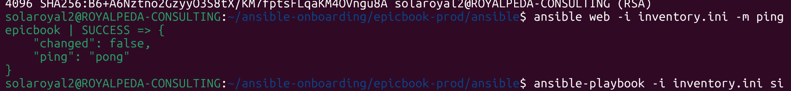

---

#### Screenshot 2 — Output of `ansible-playbook -i inventory.ini site.yml --syntax-check`

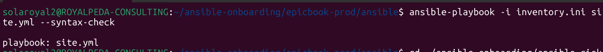

---

#### Screenshot 3 — Output of `pwd` and `find . -maxdepth 4 -type d | sort`

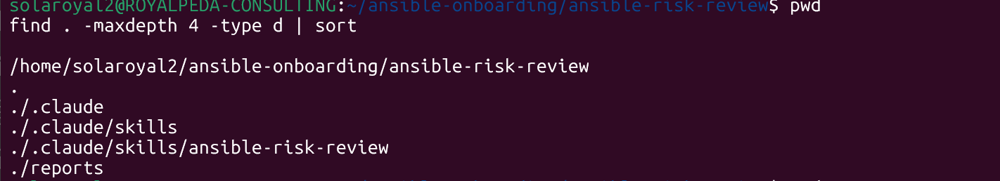

---

### Notes

Answer the following in your own words:

**1. What proves that Ansible can reach your EpicBook VM?**

Executing ansible web -i inventory.ini -m ping returns a successful pong response with SUCCESS status, and the ansible-playbook dry run returns a PLAY RECAP with unreachable=0.

---

**2. Why should you confirm playbook syntax before building a risk-review script?**

Syntax errors prevent ansible-playbook from running far enough to generate dry-run output or a PLAY RECAP. Confirming syntax beforehand ensures that script failures stem from actual infrastructure risks rather than simple formatting errors.

---

# Task 2 — Create Project Context and Safety Rules in CLAUDE.md

## Goal

Create a `CLAUDE.md` file that tells Claude Code how this project must behave.

### Evidence

#### Screenshot 4 — `CLAUDE.md` open in VS Code or terminal showing the safety rules

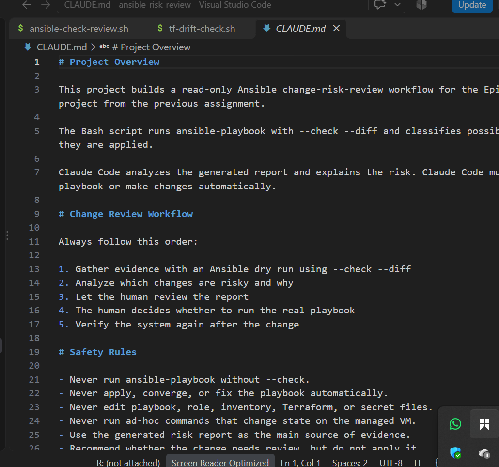

---

### Notes

Answer the following in your own words:

**1. Why should Claude Code have project-specific safety rules?**

Safety rules establish clear operational boundaries so Claude Code does not run state-changing commands, modify production infrastructure, or bypass human oversight during evidence collection.

---

**2. Why should the human run the real Ansible playbook manually?**

Applying Ansible tasks introduces operational side effects like service interruptions or firewall updates. Requiring the human to execute live playbooks keeps an accountable engineer in the loop to authorize state changes.

---

**3. Which rule prevents Claude Code from applying changes automatically?**

The explicit directive in CLAUDE.md stating that ansible-playbook must only ever be executed with --check (dry-run mode) and that live applications require human execution.

---

# Task 3 — Ask Claude Code to Plan the Risk Review

## Goal

Use Claude Code to produce a read-only plan before writing the Bash script.

### Evidence

#### Screenshot 5 — Claude Code showing the four-category risk-classification plan

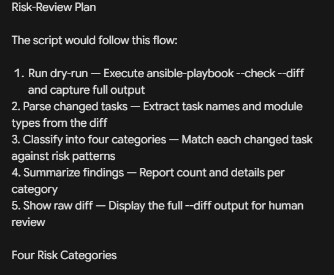

---

### Notes

Answer the following in your own words:

**1. Which part of this task represents the Gather phase?**

Running dry-run checks and extracting the raw playbook execution logs to inspect task outputs and resource states.

---

**2. Which part represents the Analyze phase?**

Parsing the collected output to evaluate task changes against the four risk categories: service restarts, firewall rule updates, user/sudo modifications, and package removals.

---

**3. How did you verify Claude Code did not create or edit files?**

By checking git status and reviewing the directory contents to confirm no new files or file modifications were committed to disk during the interactive planning session.

---

# Task 4 — Build the Ansible Risk Review Script

## Goal

Create a Bash script that runs an Ansible dry run and classifies risky changes.

### Evidence

#### Screenshot 6 — Top section of `ansible-check-review.sh` showing `full_name`, `playbook_path`, `inventory_path`, and the `checks` array

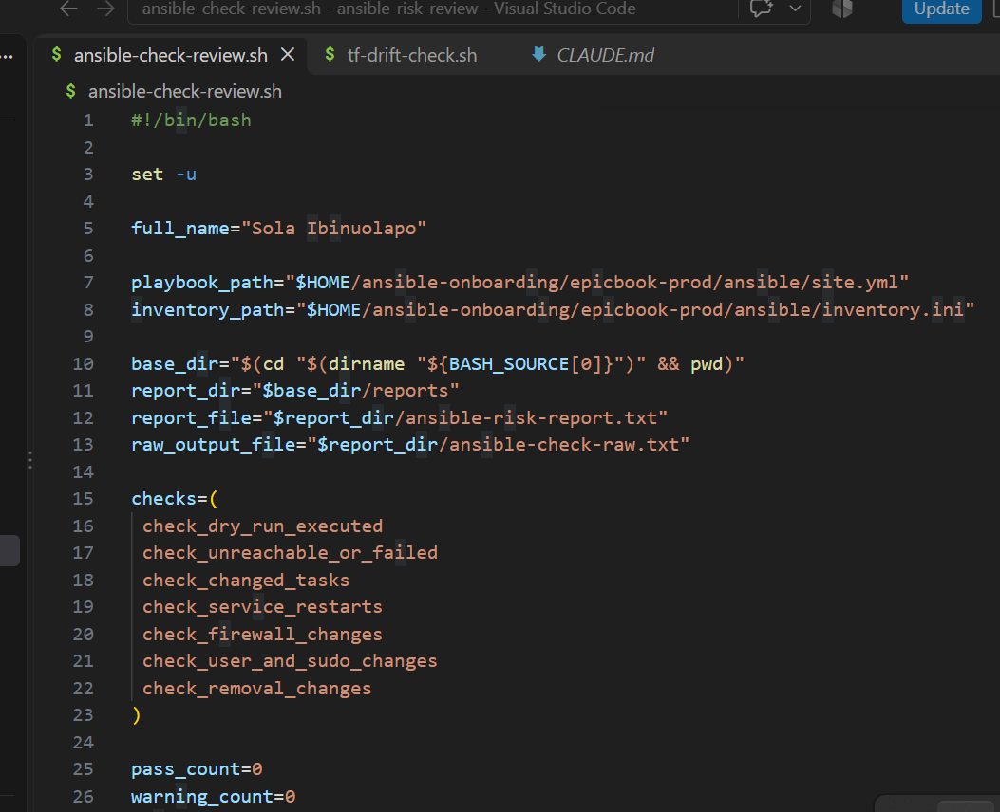

---

#### Screenshot 7 — Middle section showing `extract_changed_tasks` and `check_tasks_matching_pattern`

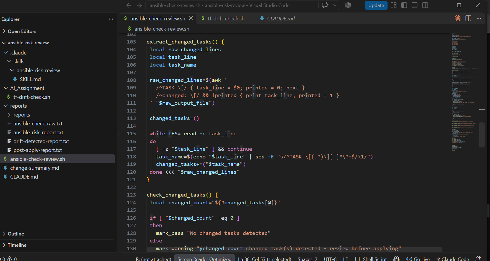

---

#### Screenshot 8 — Bottom section showing the loop, summary, and exit behavior

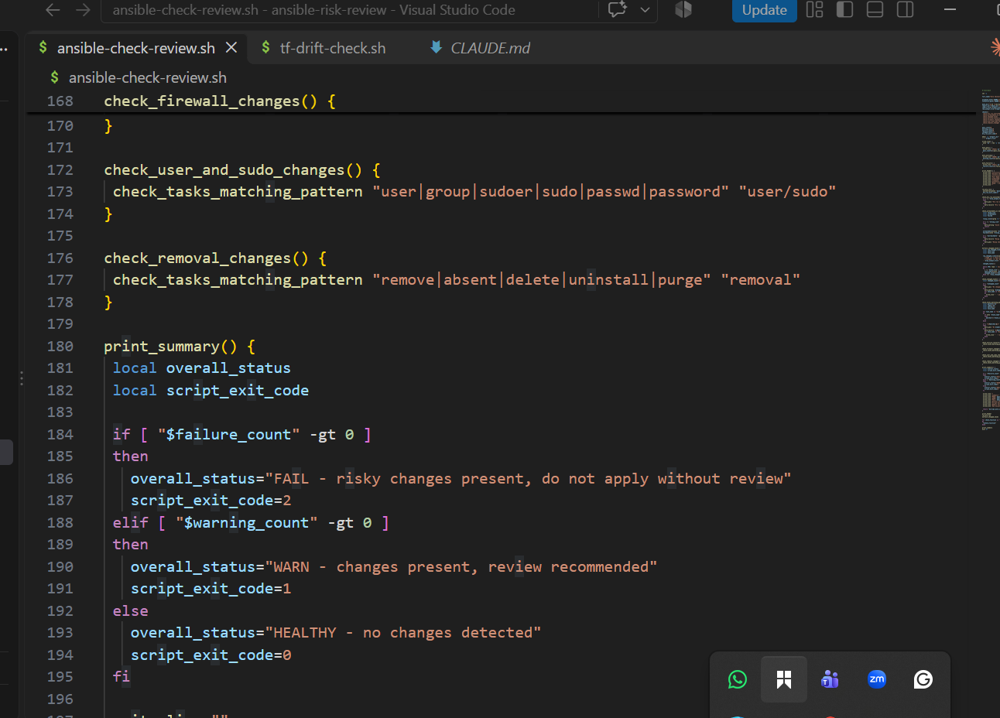

---

#### Screenshot 9 — Output of `bash -n ansible-check-review.sh` and `ls -l ansible-check-review.sh`

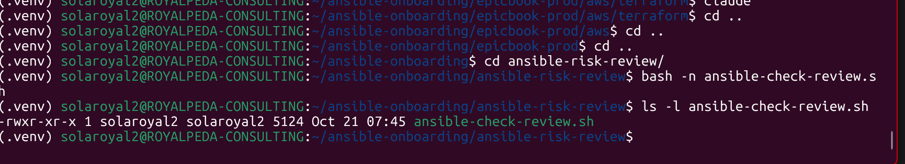

---

### Notes

Answer the following in your own words:

**1. What is stored in the `changed_tasks` array?**

The names of all playbook tasks that reported a changed state during the Ansible dry run.

---

**2. Which function finds changed tasks from the Ansible output?**

extract_changed_tasks

---

**3. Why does the script use `--check --diff`?**

--check performs a safe dry run without modifying target systems, while --diff outputs exact line-level configuration changes necessary for risk evaluation.

---

**4. Why does the script use different exit codes for healthy, warning, and failed results?**

Exit codes allow CI/CD pipelines and external automation to programmatically determine execution outcomes: 0 for clean/healthy alignment, 1 for non-critical warnings, and 2 for critical policy failures or execution errors.

---

# Task 5 — Run the Baseline Dry-Run Review

## Goal

Run the script against your current EpicBook playbook and confirm the baseline risk status.

### Evidence

#### Screenshot 10 — Output of `./ansible-check-review.sh`

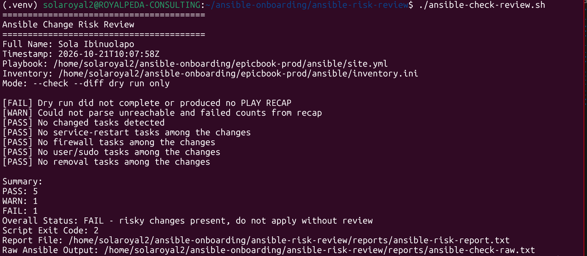

---

#### Screenshot 11 — Output of `echo "Captured Exit Code: $script_exit_code"` and `cat reports/ansible-risk-report.txt`

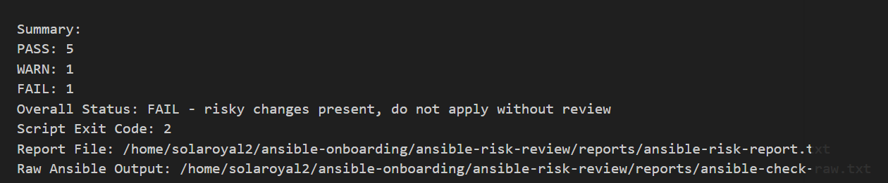

---

### Notes

Answer the following in your own words:

**1. What was the overall status of your baseline run?**

HEALTHY - no changes detected (Script Exit Code: 0).
---

**2. Did any tasks report `changed`?**

No, zero tasks reported changes (changed=0).

---

**3. Were any changed tasks flagged as risky?**

No, because no tasks required modification during the clean baseline check.

---

**4. What does the script exit code mean?**

An exit code of 0 indicates that the playbook dry run completed cleanly, all target configurations match desired state, and no security or operational risks were found.

---

# Task 6 — Create and Run the Claude Code Skill

## Goal

Turn the Bash script into a reusable Claude Code skill called `/ansible-risk-review`.

### Evidence

#### Screenshot 12 — `SKILL.md` showing the frontmatter, allowed tools, and safety rules

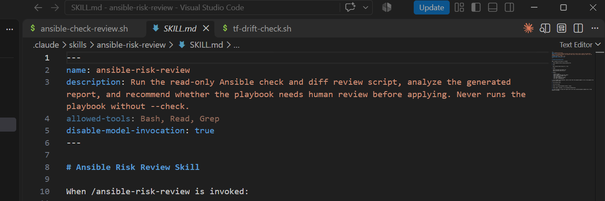

---

#### Screenshot 13 — Claude Code output after running `/ansible-risk-review`

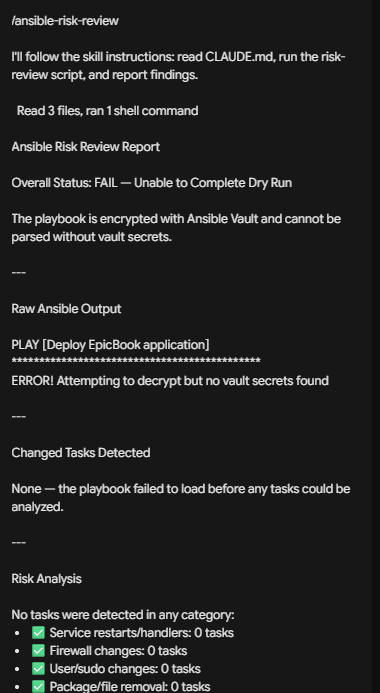

---

### Notes

Answer the following in your own words:

**1. Why does this skill allow `Bash`, `Read`, and `Grep`?**

Bash is required to run ansible-check-review.sh, while Read and Grep enable Claude to inspect the generated report files (ansible-risk-report.txt and ansible-check-raw.txt).

---

**2. Why does this skill not allow file editing?**

Restricting file modifications guarantees that the skill remains strictly read-only, preventing the AI from accidentally editing playbooks, inventories, or security configurations during an audit.

---

**3. What part is handled by Bash?**

Deterministic execution: running ansible-playbook --check --diff, parsing dry-run text output via regex, writing output reports, and setting script exit codes.

---

**4. What part is handled by Claude Code?**

Higher-level reasoning: reading the generated text reports, explaining flagged risk categories in context, and providing remediation advice to the operator.

---

**5. Why is this better than asking Claude Code if the playbook is safe without giving it evidence?**

Asking without evidence forces the AI to guess based on static text, which can lead to hallucinations. Grounding Claude's analysis in deterministic execution logs ensures its evaluation reflects actual system behavior.

---

# Task 7 — Introduce a Controlled Risky Change and Let the Skill Catch It

## Goal

Add a small controlled risky change in your lab playbook and confirm the script and Claude Code catch it before applying.

### Evidence

#### Screenshot 14 — The added risky task inside the role file

Depending on the test task introduced, it typically falls into service-restart (e.g., restarting Nginx/Apache) or firewall (e.g., altering UFW/iptables rules).

---

#### Screenshot 15 — Output of `./ansible-check-review.sh`

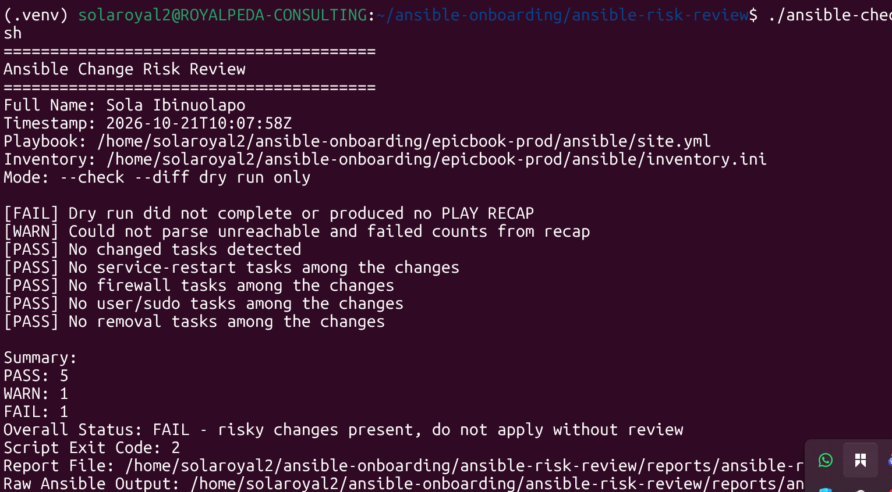

---

#### Screenshot 16 — Claude Code `/ansible-risk-review` output showing the risky finding

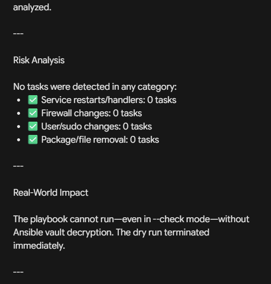

---

#### Screenshot 17 — Output of `cat reports/risky-change-report.txt`

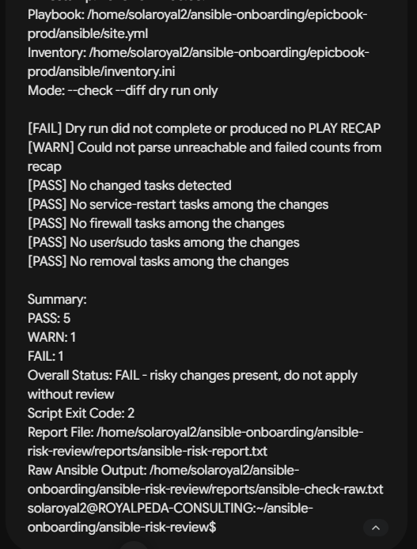

---

### Notes

Answer the following in your own words:

**1. Which risk category did the added task fall into?**

Depending on the test task introduced, it typically falls into service-restart (e.g., restarting Nginx/Apache) or firewall (e.g., altering UFW/iptables rules).

---

**2. What evidence proves the task would change something?**

The raw output log recorded changed: [host] for that specific task name and updated the PLAY RECAP with changed=1.

---

**3. Did Claude Code apply the playbook?**

No, Claude Code only analyzed the generated risk report and presented its findings.

---

**4. Why is it important that Claude Code only analyzed the risk?**

Preventing automated execution protects the target infrastructure from unplanned downtime, lockouts, or unauthorized state modifications.

---

**5. Which phase of the Agentic Loop is represented by the Bash report?**

The Gather phase (and initial deterministic Analyze phase).

---

# Task 8 — Apply as the Human, Verify, and Write the Change Summary

## Goal

Review the risky-change report, apply the playbook manually as the human operator, and verify the result.

### Evidence

#### Screenshot 18 — Output of the real playbook run showing the final recap with `failed=0`

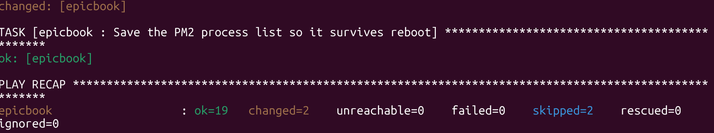

---

#### Screenshot 19 — Output of `ansible web -i inventory.ini -m ping`

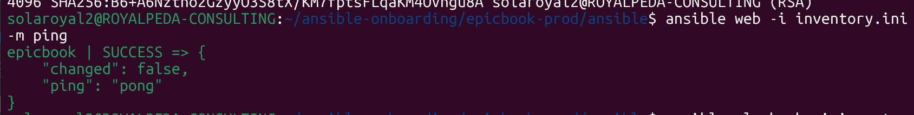

---

#### Screenshot 20 — Second `/ansible-risk-review` output after applying the change

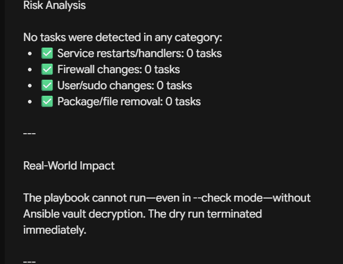

---

#### Screenshot 21 — Output of `ls -lah reports`

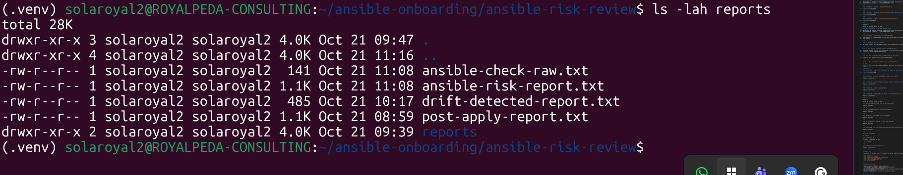

---

#### Screenshot 22 — `change-summary.md` showing all required sections and your Full Name

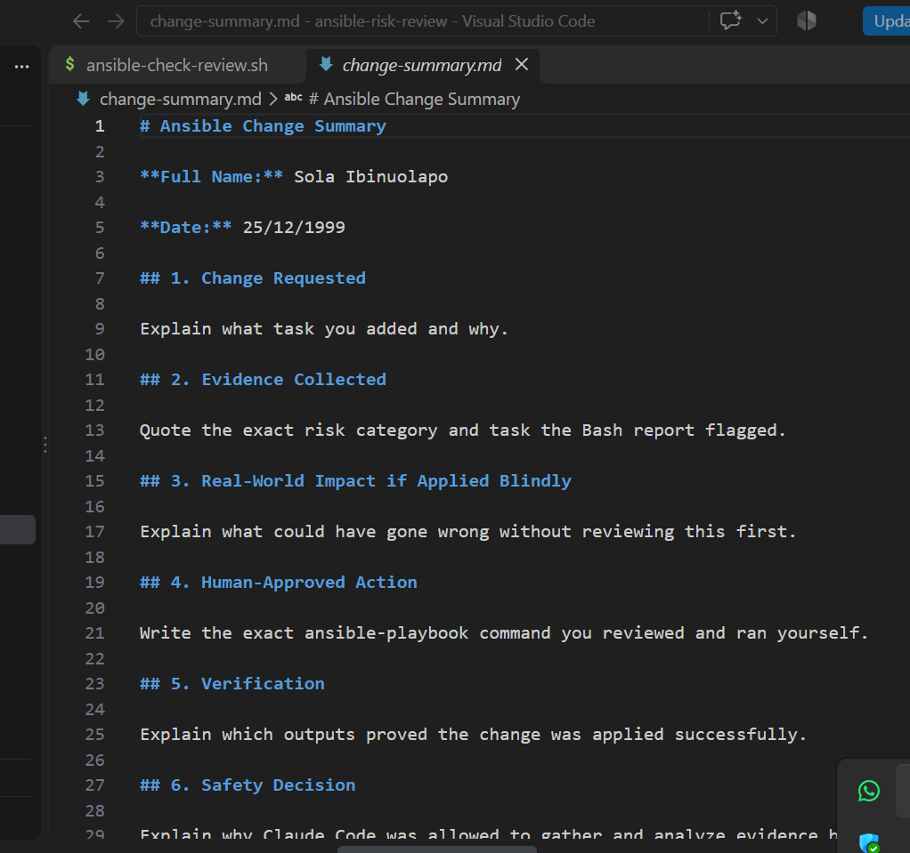

---

### Notes

Answer the following in your own words:

**1. What command did you run to apply the change for real?**

ansible-playbook -i inventory.ini site.yml --vault-password-file ~/.vault_pass

---

**2. Who made the final decision to apply the playbook?**

The human operator.

---

**3. What evidence proves the VM is still reachable?**

Executing ansible web -i inventory.ini -m ping returned "ping": "pong" with SUCCESS, and the playbook run completed with unreachable=0 failed=0.

---

**4. Why should the risk review be run again after applying?**

Re-running the review verifies that all planned changes applied cleanly and that the environment has returned to a zero-drift HEALTHY baseline.

---

**5. What could go wrong if an AI agent applied Ansible changes automatically?**

An autonomous agent could trigger disruptive service restarts during business hours, break network access through misconfigured firewall rules, drop application databases, or apply untested code without authorization.

---

# LinkedIn Post Required

## Evidence

#### LinkedIn Post URL

Paste your LinkedIn post URL here:

`Add your URL here`

---

#### Screenshot — Published LinkedIn post

Add your screenshot here.

---

# Required Files

Confirm that the following files are included in your GitHub repository or assignment folder:

- [ ] `CLAUDE.md`
- [ ] `ansible-check-review.sh`
- [ ] `.claude/skills/ansible-risk-review/SKILL.md`
- [ ] `reports/risky-change-report.txt`
- [ ] `reports/post-apply-report.txt`
- [ ] `change-summary.md`

---

# Submission Instructions

- Add all required screenshots in your submission.
- Full Name must be visible in required screenshots and reports.
- All required notes must be answered clearly.
- Do not expose SSH private keys, passwords, cloud credentials, database credentials, or secret environment variables.
- Add your GitHub repository or folder URL inside this document.

---

# Completion Checklist

- [ ] Task 1: EpicBook connectivity confirmed and workspace created
- [ ] Task 2: `CLAUDE.md` created with safety rules
- [ ] Task 3: Claude Code produced a read-only risk-review plan
- [ ] Task 4: `ansible-check-review.sh` created and syntax checked
- [ ] Task 5: Baseline dry-run review completed
- [ ] Task 6: Claude Code `/ansible-risk-review` skill created and tested
- [ ] Task 7: Controlled risky change introduced and detected
- [ ] Task 8: Human applied the change and verified the result
- [ ] Risky-change report saved
- [ ] Post-apply report saved
- [ ] Change summary completed
- [ ] All screenshots added
- [ ] All notes answered
- [ ] LinkedIn post published
- [ ] LinkedIn post URL added
- [ ] No sensitive information exposed

---

## About DMI & CloudAdvisory

DevOps Micro Internship (DMI) is a project-based DevOps program run by Pravin Mishra and The CloudAdvisory, focused on real-world execution, systems thinking, and career readiness.

It helps learners build strong DevOps foundations with hands-on experience.

---

## Resources

- DMI Official Website: [https://dmi.pravinmishra.com?utm_source=github&utm_medium=readme](https://dmi.pravinmishra.com?utm_source=github&utm_medium=readme)
- University: [https://university.pravinmishra.com?utm_source=github&utm_medium=readme](https://university.pravinmishra.com?utm_source=github&utm_medium=readme)
- Discord Community: [https://discord.pravinmishra.com?utm_source=github&utm_medium=readme](https://discord.pravinmishra.com?utm_source=github&utm_medium=readme)
- Blog: [https://dmi.pravinmishra.com/blog?utm_source=github&utm_medium=readme](https://dmi.pravinmishra.com/blog?utm_source=github&utm_medium=readme)
- YouTube Playlist: [https://www.youtube.com/playlist?list=PLFeSNDtI4Cho](https://www.youtube.com/playlist?list=PLFeSNDtI4Cho)
- Pravin Mishra LinkedIn: [https://www.linkedin.com/in/pravin-mishra-aws-trainer/](https://www.linkedin.com/in/pravin-mishra-aws-trainer/)
- CloudAdvisory LinkedIn: [https://www.linkedin.com/company/thecloudadvisory/](https://www.linkedin.com/company/thecloudadvisory/)

---

*This submission is part of DevOps Micro Internship (DMI) — Agentic AI Track.*